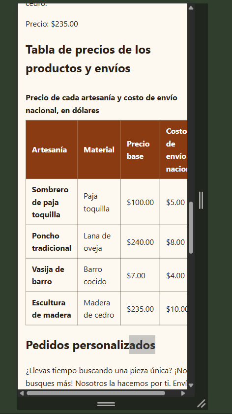
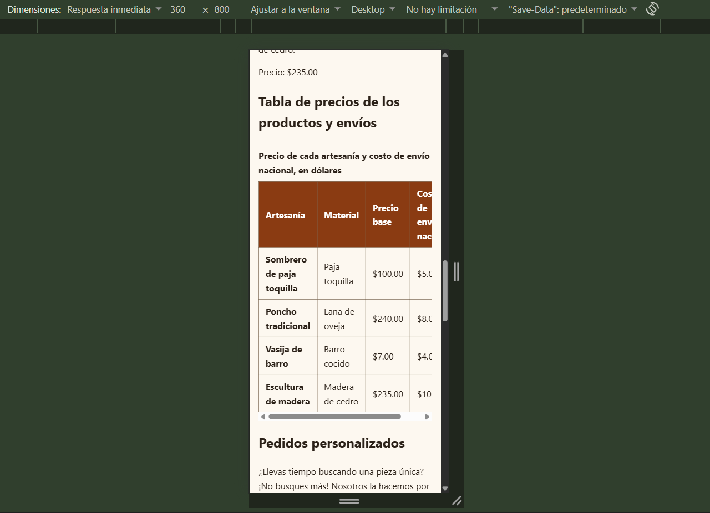
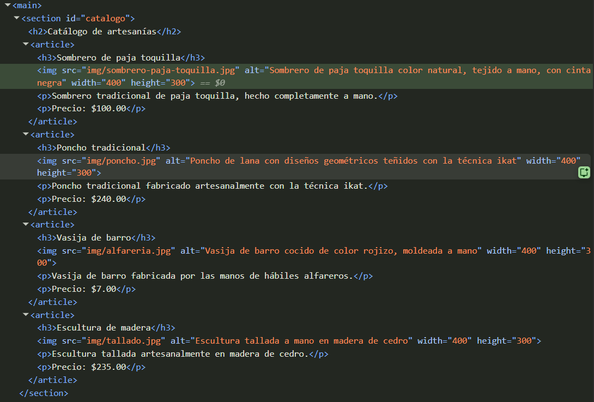
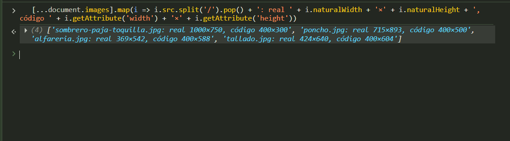

# Respuesta a la auditoría – Parte 3

* **Estudiante auditado:** Mateo Sebastián Namicela Jara
* **Estudiante auditor:** Israel Sebastián Orellana Solano
* **Fecha:** 24 de octubre de 2026

---

## 1. Respuesta a los hallazgos del informe recibido

El informe recibido registra 10 verificaciones y ningún incumplimiento.

| N.º de hallazgo | Decisión (acepta o refuta) | Justificación con la norma | Evidencia antes y después | Commit |
| :---: | :--- | :--- | :--- | :---: |
| 1 | Acepta | La estructura semántica y la jerarquía de encabezados cumplen el requisito base 1 y la especificación HTML de WHATWG. | No aplica: no requiere corrección. | No aplica |
| 2 | Acepta | El formulario cumple el requisito base 2 y los criterios 1.3.1 y 3.3.2 de WCAG 2.2. | No aplica: no requiere corrección. | No aplica |
| 3 | Acepta | El campo `input type="file"` con `accept` cumple el requisito de la ficha 19. | No aplica: no requiere corrección. | No aplica |
| 4 | Acepta | La tabla cumple el requisito base 3 y el criterio 1.3.1 de WCAG 2.2. | No aplica: no requiere corrección. | No aplica |
| 5 | Acepta parcialmente | El uso de Grid, Flexbox y el breakpoint de 600 px es correcto, pero la página sí presentaba scroll horizontal a 360 px, lo que incumple el requisito base 4 y el criterio 1.4.10 de WCAG 2.2. Se corrigió como el problema 1 de la sección 2. | [Ver evidencia 1](#evidencia-1) | `2a3e85d` |
| 6 | Acepta | Los colores se declaran como variables y el texto supera el contraste de 4.5:1 del criterio 1.4.3 de WCAG 2.2. | No aplica: no requiere corrección. | No aplica |
| 7 | Acepta | El foco visible cumple los criterios 2.1.1 y 2.4.7 de WCAG 2.2. | No aplica: no requiere corrección. | No aplica |
| 8 | Acepta | Ambos archivos pasan los validadores del W3C sin errores (requisito base 7). | No aplica: no requiere corrección. | No aplica |
| 9 | Acepta | Las imágenes tienen `alt` descriptivo según el criterio 1.1.1 de WCAG 2.2. | No aplica: no requiere corrección. | No aplica |
| 10 | Acepta | El acordeón con `details` y `summary` cumple el requisito de la ficha 19 sin JavaScript. | No aplica: no requiere corrección. | No aplica |

---

## 2. Problemas no detectados por el auditor

| N.º | Decisión | Justificación con la norma | Evidencia antes y después | Commit |
| :---: | :--- | :--- | :--- | :---: |
| 1 | Corregido | A 360 px el documento medía 378 px de ancho y aparecía scroll horizontal en toda la página. La tabla de 4 columnas necesita más ancho del disponible, y como los elementos de Grid tienen `min-width: auto`, `main` no podía encogerse por debajo de ese ancho. Se agregó `min-width: 0` a `main` (`estilos.css`, línea 33), de modo que solo la tabla se desplaza dentro de `.contenedor-tabla`. Incumplía el requisito base 4 y WCAG 2.2, criterio 1.4.10 (Reflujo, AA). | [Ver evidencia 1](#evidencia-1) | `2a3e85d` |
| 2 | Corregido | Los atributos `width="400" height="300"` de `poncho.jpg`, `alfareria.jpg` y `tallado.jpg` no coincidían con la proporción real de las imágenes (715×893, 369×542 y 424×640). La especificación HTML de WHATWG (*Dimension attributes*) exige que la proporción de `width` y `height` sea igual a la de la imagen. Se cambiaron a 400×500, 400×588 y 400×604 (`index.html`, líneas 47, 56 y 65). | [Ver evidencia 2](#evidencia-2) | `09e4960` |

---

## 3. Evidencias

### Evidencia 1

**Antes:** a 360 px aparece la barra de scroll horizontal en toda la página.

**Después:** la página ya no tiene scroll horizontal; solo la tabla se desplaza dentro de su contenedor.

### Evidencia 2

**Antes:** las cuatro imágenes tienen `width="400" height="300"` en el código.

**Después:** los atributos `width` y `height` tienen la misma proporción que el tamaño real de cada imagen.

